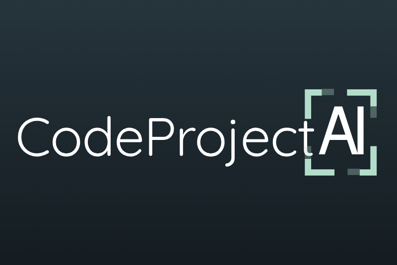

# CodeProject.AI for Gladys Assistant



An external integration for [Gladys Assistant](https://gladysassistant.com) that runs the **local
object detection and face recognition** of [CodeProject.AI Server](https://www.codeproject.com/ai) on
the images of your cameras: a person, a car, a dog, a known face… without the cloud.

Tested against a real CodeProject.AI Server in Docker (`codeproject/ai-server` 2.9.7, CPU) with free
photos; developed without real cameras in service: feedback welcome.

## Features

- Up to **four cameras**, each a JPEG snapshot URL (`http://user:password@…/snapshot.jpg`).
- **One device per camera**: the analyzed image with the boxes drawn (shrunk to the 150 KB Gladys
  takes), "Object detected" (Yes/No), "Objects detected" ("Person ×2, Car"), one counter per searched
  label, and "Recognized face" when face recognition is on.
- **One device for the server**: the modules running, the mean detection time; its badge says when
  the server does not answer.
- Searched labels (or `*`) and minimum confidence, overridable per camera; analysis every 10 seconds
  to 1 hour, one camera after the other, or on demand only.
- **Faces**: "Register a face" saves the face in the current picture of a camera under a name,
  "Delete a face" forgets it; recognition runs only when a person is in view.
- **Scenes**: "Object detected by CodeProject.AI" when an object appears, "Face seen by
  CodeProject.AI" (known or unknown), "Camera image not read"; the action "Analyze a camera with
  CodeProject.AI" returns the objects, counts, persons, confidence and faces to the next actions.
- **Dashboard widget**: the image, the objects, the faces, the counts, an "Analyze now" button that a
  setting hides.
- English, French, German and Spanish.

## Requirements

- Gladys 5.1 or later.
- A CodeProject.AI Server (`docker run -d -p 32168:32168 codeproject/ai-server`) reachable from
  Gladys, with an object detection module started (and Face Processing for the faces).
- A JPEG snapshot URL per camera. An external integration cannot read the image of a camera another
  integration put in Gladys; RTSP streams would need ffmpeg in the container.

## Installation

In Gladys: **Integrations → Install from GitHub**, address
`https://github.com/guim31/gladys-codeproject-ai`. Then fill in the server address and the cameras,
run **Check the connection**, and add the devices from the **Discovery** tab. The full guide:
[docs/en.md](docs/en.md) ([fr](docs/fr.md), [de](docs/de.md), [es](docs/es.md)).

## How it works

- `GET /v1/server/status/ping` and `/v1/module/list/status` check the server and its modules (an
  object detection module must be started); `POST /v1/vision/detection` uploads the snapshot
  (multipart) with the minimum confidence; with a person in view and face recognition on,
  `POST /v1/vision/face/recognize` names the faces. `face/register`, `face/delete` and `face/list`
  serve the actions.
- Snapshots are downloaded by the integration (credentials in the URL become a Basic header), so
  "camera unreachable" and "server unreachable" stay apart.
- CodeProject.AI returns boxes in pixels, not a picture: the integration draws them and shrinks the
  picture in a worker thread with a small pure-JavaScript JPEG decoder and `jpeg-js` (no native
  module), within the 256 MB of the sandbox.
- The devices are published with `should_poll: false`: the integration's own timer analyzes the
  devices added in Gladys only, and skips one analyzed on demand less than half an interval ago.
  States are published only when they change, with a heartbeat every 12 hours.

## Checked, and what was not

Checked for real, in Docker: the client against `codeproject/ai-server` 2.9.7 (ping, modules,
detections on a street, a car and a portrait, face recognition before and after registration, face
deletion, a picture without a face, bytes that are not an image, a module not installed, server
stopped), and the integration image in the Gladys sandbox constraints against that server and a test
camera serving JPEG snapshots, driven by the fake Gladys of the SDK. The recorded answers are the
fixtures of the tests (`test/fixtures/cpai`).

Not checked: real IP cameras (snapshot formats, Digest authentication), a GPU or Coral server, other
detection modules (YOLOv8, Coral…: same API), a real Gladys instance.

## Limits

- Four cameras, eight counted labels per camera, no RTSP, no license plates, no custom models.
- One picture per analysis: an object passing between two analyses is missed.
- HTTP Digest authentication is not supported.
- Each analysis costs CPU on the CodeProject.AI machine: see the documentation for the interval.

## Development

```bash
npm ci
npm test
npm run lint
npm run format:check
npx github:GladysAssistant/integration-store .
```

See [CLAUDE.md](CLAUDE.md) for the architecture and the rules of the code.

## Credits

- [CodeProject.AI Server](https://github.com/codeproject/CodeProject.AI-Server) (by CodeProject):
  its API documentation and answers, recorded for the tests. The DeepStack-compatible API is also
  what the Home Assistant custom components `deepstack_object` and `deepstack_face` (by Robin Cole,
  MIT) use.
- The detections in `test/fixtures/cpai` were recorded on photos from Wikimedia Commons (not in the
  repository): "2019 Toyota Corolla Icon Tech VVT-i Hybrid 1.8" by Vauxford (CC BY-SA 4.0),
  "Pedestrians on a crosswalk (Unsplash)" (CC0), "President Barack Obama" and "Official portrait of
  Barack Obama" by Pete Souza (public domain, White House); the registered name is replaced by
  "Alice" in the fixtures.
- The cover shows the official CodeProject.AI logo (`codeprojectAI-white.svg` of the
  CodeProject.AI-Server repository), trademark of CodeProject.
- The JPEG resizing comes from guim31/gladys-doods and guim31/gladys-shinobi (Apache 2.0).

This integration is not affiliated with CodeProject.

## License

[Apache 2.0](LICENSE)
